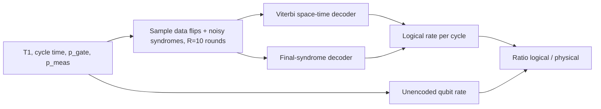
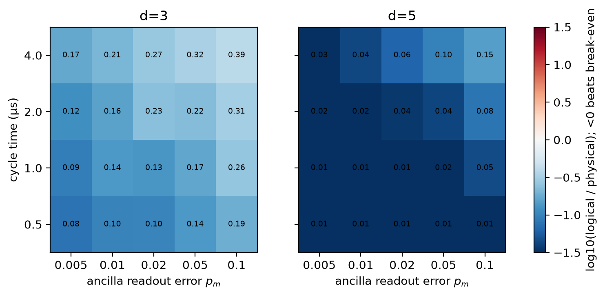
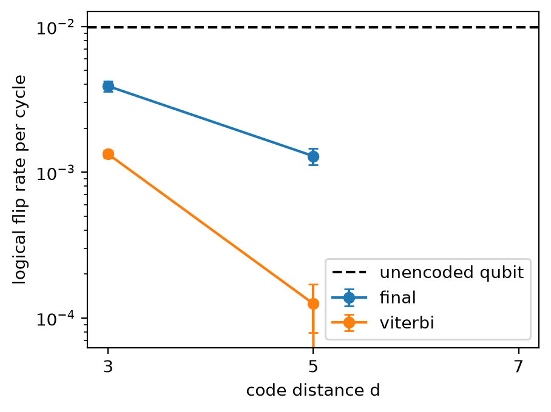
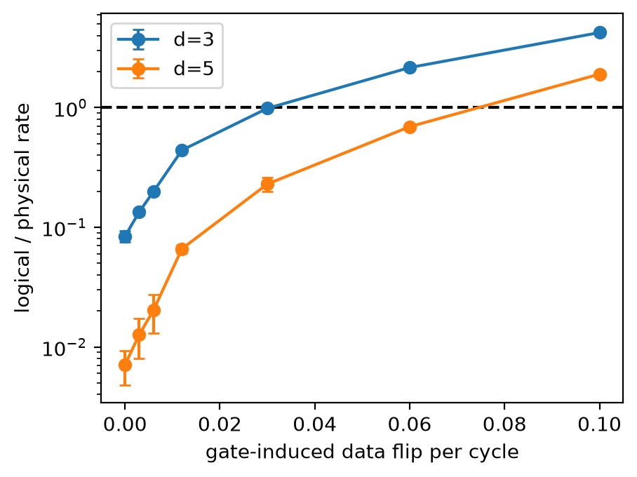

# Repetition-code break-even map

  

**Abstract.** This simulation study maps how much margin a distance-3/5/7 bit-flip repetition-code memory has before encoding stops beating a single idling qubit, as a function of QEC cycle time, ancilla readout error and gate-induced data errors under T1-limited (Pauli-twirled) noise. An exact space-time (Viterbi) decoder is compared with an unencoded qubit and with a history-free final-syndrome decoder. In this model every point of the cycle-time × readout-error grid beats break-even, and the gate-error margin is where the real limit appears.

## Motivation and gap
Real-time QEC beyond break-even has been demonstrated (Sivak et al., 2023, doi:10.1038/s41586-023-05782-6), with the practicality of extending coherence called an open question; two-qubit gate fidelities are approaching code thresholds (Evered et al., 2023, doi:10.1038/s41586-023-06481-y). Break-even is normally one experimental point. Here I quantify the *margin* around it, which matters for hardware characterisation and resource estimation. See `docs/RESEARCH_GAP.md` and `docs/METHOD.md`.

## Method

Noise: p_idle = (1-exp(-t/T1))/2 with T1 = 50 µs, plus p_gate flip per cycle on data qubits and p_meas flip on every ancilla readout; final readout ideal. Only bit flips (T1-twirled) are modelled.

## Results (4 seeds, mean ± std; all numbers in `results/results.csv`)
Ratio = logical / physical per-cycle flip rate (below 1 beats break-even).

| Setting (cycle 1 µs, p_meas 0.02, p_gate 0.003) | logical rate/cycle | ratio |
|---|---|---|
| unencoded qubit | 0.00990 | 1 |
| d=3, final-syndrome decoder | 0.00389 ± 0.00033 | 0.393 ± 0.033 |
| d=3, Viterbi | 0.00133 ± 0.00008 | 0.134 ± 0.008 |
| d=5, final-syndrome decoder | 0.00129 ± 0.00017 | 0.130 ± 0.017 |
| d=5, Viterbi | 0.00013 ± 0.00005 | 0.0126 ± 0.0046 |
| d=7, Viterbi | 0 failures in 4×1500 shots (unresolved) | – |

Noise grid (cycle 0.5-4 µs × p_meas 0.005-0.1 at p_gate 0.003): ratio ranges 0.079-0.391 for d=3 and 0.0050-0.151 for d=5; the worst corner (4 µs, p_meas 0.1) gives 0.391 (d=3) and 0.151 (d=5).

Gate-induced flip sweep (ratio, cycle 1 µs, p_meas 0.02):

| p_gate | 0 | 0.003 | 0.012 | 0.03 | 0.06 | 0.1 |
|---|---|---|---|---|---|---|
| d=3 | 0.084 | 0.134 | 0.441 | 0.985 ± 0.035 | 2.16 ± 0.07 | 4.23 ± 0.10 |
| d=5 | 0.0071 | 0.0126 | 0.066 | 0.229 | 0.692 | 1.90 ± 0.04 |

So break-even is lost near p_gate ≈ 0.03 for d=3 and between 0.06 and 0.1 for d=5.


 

## Discussion
The hypothesis (all grid points < 1; gate break-even > 1%) holds in this model. The space-time decoder is the main lever: d=3 Viterbi (0.134) is comparable to d=5 with the history-free decoder (0.130). Cycle time and readout error matter comparably in this model: going from 0.5 to 4 µs raises the d=3 ratio from 0.079-0.186 to 0.170-0.391, (8× longer), and p_meas from 0.005 to 0.1 (20× worse) raises it by a similar factor of about 2.3×. Negative/neutral points: d=7 produced no failures, so it gives no number; the model is optimistic because it has no Z errors, leakage, correlated or coherent noise, and twirling discards the T1 asymmetry (a decoder could exploit it).

## Limitations
Phenomenological, independent noise; bit-flip code protects only population, not phase (a full quantum memory would not break even with this code alone); ideal final readout; simulation only, no hardware data; T1 fixed at 50 µs.

## Future work
Add Z noise and a surface-code/XZZX memory, calibrate p_gate, p_meas and cycle time from device characterisation data, feed the margin into qubit-count resource estimates, and fit the model to a real repetition-code experiment.

## Reproducibility
```
pip install -r requirements.txt && pip install -e .
pytest -q
python experiments/run_all.py --quick   # seconds
python experiments/run_all.py           # full run, 195 s on a 16-thread Windows 11 laptop (CPU only)
```
Related work by the author: [erasure-local-stabiliser-measurements](https://github.com/pradeepdegalaroyal/erasure-local-stabiliser-measurements), [qaoa-best-of-k-sampling-noise](https://github.com/pradeepdegalaroyal/qaoa-best-of-k-sampling-noise).

## Structure
`src/repmem/` simulator and decoders · `experiments/run_all.py` · `tests/` · `results/` · `figures/` · `docs/`

## Citation
See `CITATION.cff`. License: MIT.
